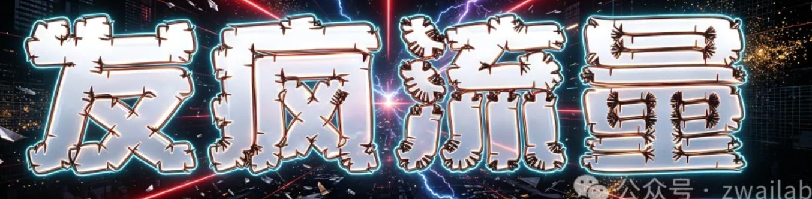
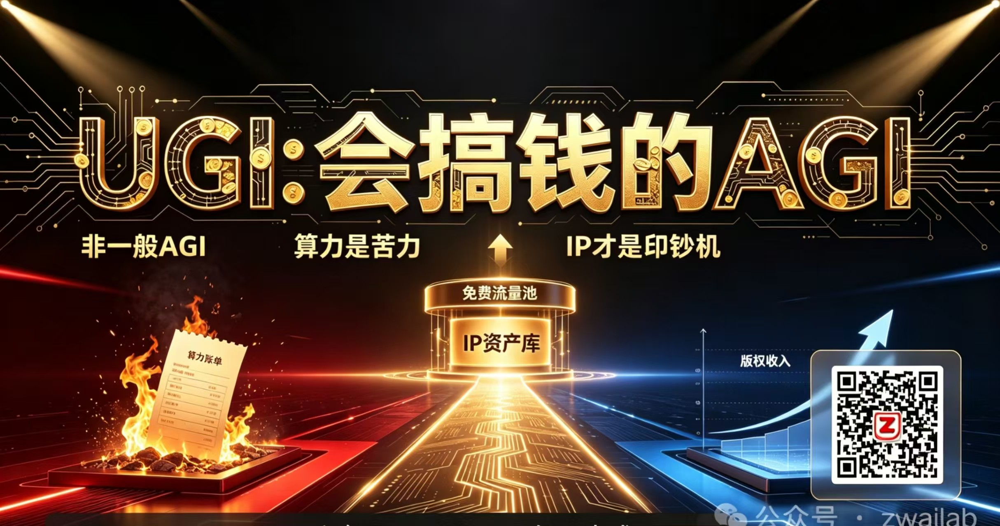
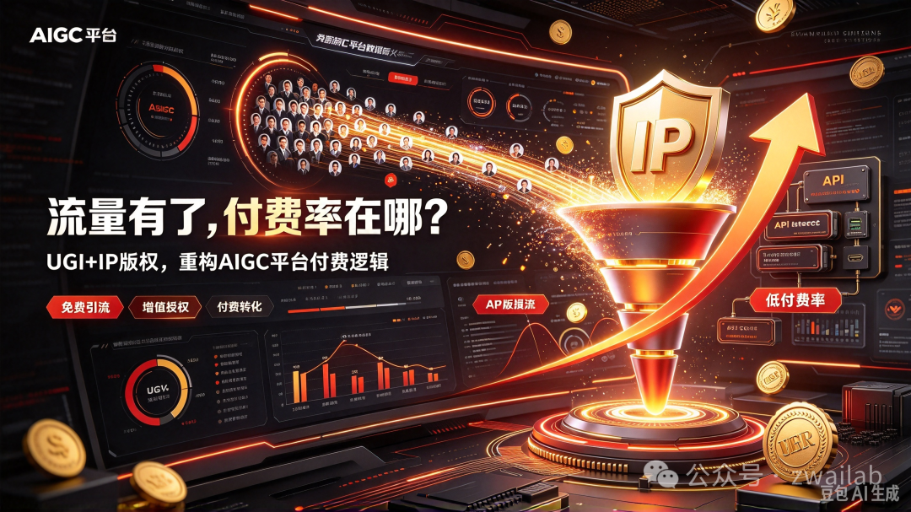
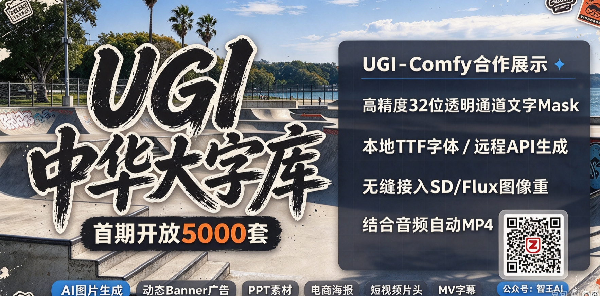
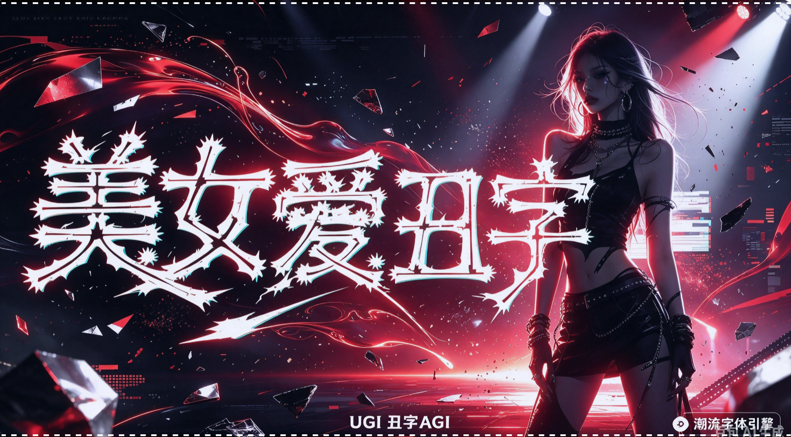
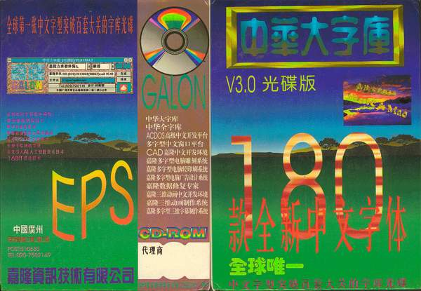

---
tasks:
- text-to-image-synthesis
---
# 项目名
## UGI = usdt-AGI
- slogan口号：UGI，会搞钱的AGI
- ps:$usdt，是数字币，稳定币的代表。

##

# 四大特点
- （汉字）乱笔终结者：zw首创text-mask，直接调用汉字轮廓节点数据，理论上100%无乱笔。部分bug，后期aigc模型渲染bug。但也可降低90%汉字乱笔。
- 3s引流神器：3s视觉锤，ugi带来10x关注度，打个对折，也有3-5x成交量
- IP版权：ugi底层核心资产《中华大字库》,多套国家版权局IP版权证书&dci数字版权证书。
- 10x高效：根据tag标签，自动挑选字体，批量生成多组备选素材品，10x高效
- -  万套国标二级字库，全球规模最大的个性化中文字库
- -  全球首个情绪化字库,引流神器，3s视觉锤：粘土（牛来）体，屌丝体，肥仔体，......
- -  全球首个智能字库, 全球首创mtag智能标签。
<video src="./UGI入门教程_v1.0.mp4" controls width="100%"></video>
- UGI新丑风小白入门保姆教程_v3.0.pdf https://www.modelscope.cn/models/bd25vip/ugi-font/UGI新丑风小白入门保姆教程_v3.2.pdf
- 
- UGI-ComfyUI 插件： https://www.modelscope.cn/models/bd25vip/ugi-comfy/
- 
# 安装与下载
- UGI-font技能，已经在workbuddy平台上架，搜索技能：ugi font，按平台说明安装
- - UGI skill技能主站：
- - 魔塔: https://www.modelscope.cn/models/bd25vip/ugi-font/
- - github: https://github.com/m-f-vip/ugi-font
- - 文件名：ugi-free-v2.5.1-开放平台技能包.zip ， 版本号会随时更新
- 以下agent平台，均已经测试通过。
- - workbuddy，豆包工作，百度搭子，千问工作，dsh，hermes，讯飞loomy
- 
- 【手动安装】
- - 下载后，各大agent平台，输入提示词：
- - 请安装ugi字体skill，文件名：<ugi font文件名>
<video src="./UGI教程demo2.mp4" controls width="100%"></video>
- UGI“发疯情绪字体+CTR春药”插件，让小B商家付费率狂飙！
https://mp.weixin.qq.com/s/kPDMobxLDGe1ISFVm7OdEQ
- 《算力是苦力，IP是印钞机！UGI“会搞钱的AGI”，如何让AI平台付费率狂飙10倍？》 https://mp.weixin.qq.com/s/ZNhQ2L6ZfD0nPElYzBUPag

- 
# 简介
- UGI（usdt-AGI）是专为AIGC设计的广告 / 海报 / 短视频生成插件/skill，
- UGI全球首创的zw-text-mask，是zw骨架网基础应用。
- 可广泛用于 AIGC 图片生成、动态 Banner 广告、PPT 素材、电商海报、短视频片头、MV 字幕、游戏素材等场景。
- 它不需要加载任何扩散模型，直接通过本地 TTF 字体或远程 API 
- 生成高精度的 32 位透明通道文字 Mask，无缝接入下游 SD / Flux 图像重绘，结合音频自动压制 MP4。
- 核心资产《中华大字库》万套国标二级个性化中文字库，100% 原创 IP 知识产权；
- 内置 AI 字形隐形水印，实现字形风格版权溯源。

# 核心特性
- •	零扩散模型依赖：独立生成高精度 32 位透明通道文字 Mask，节省算力。
- •	万套原创 IP 字库：《中华大字库》国标二级个性化中文字库，100% 原创，可商用授权。
- •	AI 字形隐形水印：字形风格版权溯源，截图、裁切、AI 重绘仍可举证。
- •	情绪化字体矩阵：屌丝体、牛来体（zw 粘土体）等自带流量属性的引流字体。
- •	小白友好：预制成熟工作流，拖拽即用，本地离线运行，无需调参。
- •	免费预览付费商用：免费生成效果图，付费解锁完整字库与商用授权。
# 教程
- 《UGI入门教程_v1.0.mp4》视频教程1
- 《UGI教程demo2.mp4》视频教程2
- UGI入门教程_视频-提示词.txt
- UGI新丑风小白入门保姆教程_v3.0.pdf

# UGI-API 演示
- UGI-API 在线演示（免费体验）：http://gradio.font.z-w.vip/
- zw 多模态图灵测试：https://github.com/m-f-vip/zw26
# 版权与授权
- CBF《中华大字库》已注册，100% 原创 IP 知识产权。免费预览版仅限测试与效果验证；商用需获取授权。AI 字形隐形水印用于字形风格版权溯源，不支持移除。
- 下图为90版CBF《中华大字库》光碟封面，当时投资约百万。

# FAQ
- •	Q：需要高端显卡吗？ A：不需要加载扩散模型，普通本地显卡即可运行。
- •	Q：字体可以商用吗？ A：免费版仅预览；商用需解锁完整字库文件与商用授权。
- •	Q：被盗版怎么办？ A：AI 字形隐形水印支持溯源举证。
- •	Q：SDXL/Flux现在也能写对汉字了，还需要UGI吗？
-   A：大模型能写对黑体等传统字体，但能写出带商用版权且不被索赔的‘椰树发疯体’吗？
-   UGI核心是（个性化）情绪流量+100%汉字无乱笔+商用版权免责，不是单纯的汉字图像生成。

# ugi-font系列免费skll，行业细分版
- 参见skill目录下载，手动安装
-
- ugi-avatar-text | 头像昵称字（免费） 
- ugi-brand-poster | 品牌海报 / 新品发布主视觉字 | 方案 Q.3「品牌海报·新品发布·小微品牌·可商用品牌字」
- ugi-certificate | 荣誉证书 / 奖状主标题 | G8 品牌 B 端 |
- ugi-chapter-title | PPT 章节过渡页标题 | G3 PPT 汇报 |
- ugi-club-recruit | 游戏公会 / 战队招新标题 | G11 游戏二次元 |
- ugi-coupon-word | 电商优惠券促销标题 | G4 电商促销 |
- ugi-course-cover | 在线课程 / 专栏封面标题 | G9 教育知识 |
- ugi-daily-quote | 日签 / 金句配图 / 心情卡字 | G5 社交日签高价值细分 |
- ugi-detail-point | 商品详情页卖点标题 | G4 电商商品 |
- ugi-drama-cover | 短剧封面字（免费） 
- ugi-edu-card | 知识卡片 / 课件知识点标题字 | 方案场景组 G9 教育知识 |
- ugi-festival-word | 节庆祝福大字（春节/中秋） | 附录 D 域 G7 节庆节点 |
- ugi-game-title | 游戏二次元 / 电竞封面标题字 | 方案视觉方向「赛博霓虹·游戏/二次元/年轻」
- ugi-gzh-cover | 公众号首图字（免费） | 公众号首图标题 
- ugi-handbook-word | 手账标题 / 手写风贴纸字 | 方案 Q.3「手账·周边·手写风标题字」
- ugi-jianying-cover | 剪映封面标题字 | 正文长尾「剪映封面标题字」 |
- ugi-live-banner | 直播间横幅 / 进房欢迎字 | 正文「直播贴片」（与 price-tag 的价格牌区分） |
- ugi-live-cover | 开播封面字（免费） 
- ugi-meme-text | 梗图配字（免费） 
- ugi-moments-word | 朋友圈配图文案字 | G5 社交日签 |
- ugi-name-card | 名片 / 电子请柬 / 请帖主题字 | G8 品牌 B 端高价值细分（礼仪场景） |
- ugi-plan-table | 手账计划表 / 打卡表标题 | G10 手账周边 |
- ugi-podcast-cover | 播客 / 音频节目封面标题 | G1 内容封面 |
- ugi-poster-title | 活动海报字（免费） | 活动主视觉大字 
- ugi-ppt-cover | PPT封面字（免费） | PPT 封面主标题 
- ugi-ppt-number | 数据大字（免费） 
- ugi-price-tag | 直播价格牌 / 促销价签 | 正文长尾「直播价格牌」
- ugi-product-title | 电商主图字（免费） | 电商主图标题 
- ugi-redpacket-word | 微信红包封面祝福字 | G7 节庆节点 |
- ugi-resume-title | 求职简历姓名与标题 | G8 个人职场 |
- ugi-store-sign | 门店招牌 / 橱窗字 | 附录 D 域 G6 海报门店 |
- ugi-travel-sign | 文旅打卡字（免费） 
- ugi-video-cover | 短视频封面字（免费） | 短视频封面大字 
- ugi-wall-poster | 企业文化墙标语大字 | G6 海报物料 |
- ugi-xhs-cover | 小红书封面字（免费） | 小红书封面主标题 
- ugi-xhs-title | 小红书笔记内文小标题 | 

